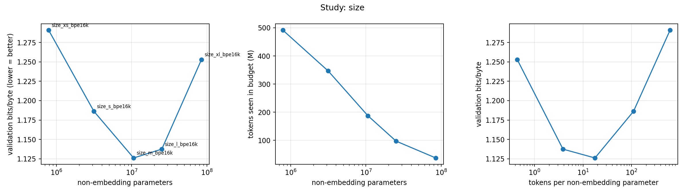
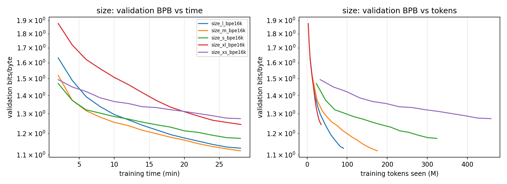
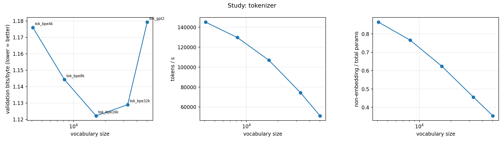
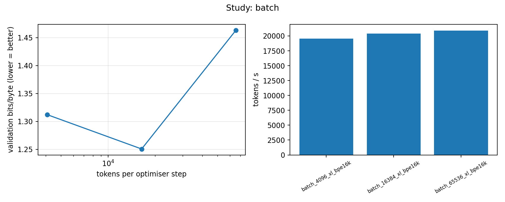

# DSA4212 Group 10 - Training Small Language Models under a Fixed Compute Budget

## Project Overview

This project investigates the relationship between model size, training data exposure, and language model performance under a fixed computational budget.

Our primary research question is:

**Under a fixed GPU-time budget, can a smaller Transformer trained on more tokens outperform a larger Transformer trained on fewer tokens?**

We implement GPT-style decoder-only Transformer language models from scratch using a nanoGPT-inspired architecture and train them on WikiText-103 using a single NVIDIA Tesla T4 GPU in Google Colab. All neural weights are randomly initialised; no pretrained neural weights or embeddings are used.

In addition to model size, we investigate tokenizer vocabulary size, learning-rate selection, batch-size sensitivity, and repeated runs.

**Main finding:** the medium-sized model (M, 17.01M parameters) achieves the lowest validation and held-out test bits-per-byte (BPB) among the five model sizes trained under the same 30-minute GPU-time budget. Three repeats of M (mean test BPB 1.1544) and L (1.1638) preserve this ordering. Our conclusions concern the tested configurations and budget and not a universal optimal model size.

The final report is in [`report/`](report/).

## 1. Key Findings

### 1.1 Model Size versus Training Tokens

Five Transformer configurations were trained for 1,800 seconds each using the BPE16K tokenizer.

| Model | Total Parameters | Tokens Trained | Exposure (equiv. epochs) | Validation BPB ↓ | Test BPB ↓ |
|-------|-----------------:|---------------:|-------------------------:|-----------------:|-----------:|
| XS    | 2.92M            | 491.36M        | 3.97                     | 1.2907           | 1.3102     |
| S     | 7.41M            | 346.57M        | 2.80                     | 1.1862           | 1.2068     |
| **M** | **17.01M**       | **187.43M**    | **1.51**                 | **1.1261**       | **1.1461** |
| L     | 33.69M           | 97.17M         | 0.78                     | 1.1375           | 1.1564     |
| XL    | 97.73M           | 37.26M         | 0.30                     | 1.2530           | 1.2710     |

M achieves the best performance despite processing fewer tokens than XS and S. It uses 17.4% of XL's parameters, processes 5.03 times as many tokens, and its test BPB is about 0.125 (9.8%) lower. Its advantage over L is smaller (0.0103 BPB).

Very small models process more tokens but appear capacity-limited; the largest model has more capacity but receives much less training exposure. Neither mechanism is isolated experimentally. The size study changes depth, width, and learning rate jointly, so it compares practical configurations rather than the isolated effect of parameter count.



The validation curves below use a fixed subset of validation windows and are not full-split final evaluations.



### 1.2 Tokenizer Comparison

Five tokenizers were evaluated using the M-sized model, one run each.

| Tokenizer   | Vocabulary Size | Bytes/token | Tokens Trained | Validation BPB ↓ | Test BPB ↓ |
|-------------|----------------:|------------:|---------------:|-----------------:|-----------:|
| GPT-2       | 50,257          | 4.520       | 92.13M         | 1.1793           | 1.2038     |
| BPE 4K      | 4,096           | 3.494       | 261.01M        | 1.1760           | 1.1921     |
| BPE 8K      | 8,192           | 3.964       | 233.37M        | 1.1443           | 1.1627     |
| **BPE 16K** | **16,384**      | **4.371**   | **192.43M**    | **1.1222**       | **1.1447** |
| BPE 32K     | 32,768          | 4.678       | 133.89M        | 1.1290           | 1.1530     |

BPE 16K had the lowest observed validation and test BPB and was used for the size study. However, the same nominal configuration (M + BPE16K) gave test BPB of 1.1447 (tokenizer run), 1.1461 (size run), and 1.1544 ± 0.0031 (mean of three repeats). This run-to-run spread of about 0.01 BPB is comparable to the gaps between BPE 16K and BPE 8K/32K, so the ordering among those three is not resolved by single runs. BPE 4K and GPT-2 are worse by roughly 0.04 BPB or more.

Moving from BPE16K to BPE32K doubles the tied embedding matrix (6.29M to 12.58M parameters) while bytes/token rises only about 7%.



### 1.3 Batch-Size Sensitivity

The XL model was evaluated with three effective batch sizes, with learning rate scaled as `0.0016 * sqrt(b / 16384)`.

| Tokens per Optimizer Step | Learning Rate | Steps | Tokens Trained | Validation BPB ↓ |
|--------------------------:|--------------:|------:|---------------:|-----------------:|
| 4,096                     | 0.0008        | 8,589 | 35.18M         | 1.3119           |
| **16,384**                | **0.0016**    | 2,242 | 36.73M         | **1.2505**       |
| 65,536                    | 0.0032        | 575   | 37.68M         | 1.4633           |

The baseline batch size achieved the lowest validation BPB. Because learning rate changes with batch size, this experiment measures a joint batch/LR policy rather than batch size alone. The common 100-step warm-up also covers a much larger fraction of the largest-batch run (17.4%) than of the baseline (4.5%).



### 1.4 Repeated Runs

M and L were each repeated with seeds 1337, 1338, and 1339.

| Model | Runs | Validation BPB (mean ± SD) | Test BPB (mean ± SD) |
|-------|-----:|---------------------------:|---------------------:|
| **M** | 3    | **1.13418 ± 0.00181**      | **1.15438 ± 0.00310** |
| L     | 3    | 1.14385 ± 0.00062          | 1.16380 ± 0.00164     |

Every M repeat has lower test BPB than every L repeat (mean gap 0.00942). This supports the main ranking but is a small replication study, not a formal significance claim.

Because training is time-limited, throughput varies between executions: M processed 152.57M to 163.99M tokens in the repeats versus 187.43M in the original size run. The reported standard deviations therefore combine seed and execution variability and should not be read as pure initialisation noise.

### 1.5 Non-Neural References

On test data, a BPE4K unigram model obtains 2.8483 BPB and an interpolated bigram model 1.9267, compared with 1.1921 for the M Transformer using BPE4K. A bzip2 reference obtains 2.2063 bits per byte but adapts to the evaluated text, so it is not an equivalent train-fitted held-out language model.

## 2. Experimental Setup

### 2.1 Dataset

We use **WikiText-103 raw (`wikitext-103-raw-v1`)** with its official training, validation, and test splits.

- **Training:** model optimisation and custom tokenizer fitting.
- **Validation:** learning-rate tuning, configuration selection, and the batch study.
- **Test:** final held-out evaluation of 16 neural checkpoints (Section 4).

Custom byte-level BPE tokenizers are trained on the training split only. GPT-2 tokenization is provided through `tiktoken`. Each non-null text row is encoded and followed by an encoded newline.

### 2.2 Model Architecture

Decoder-only GPT-style Transformer inspired by nanoGPT: causal self-attention, pre-layer normalisation, GELU feed-forward layers of width 4d, learned positional embeddings, tied input/output embeddings, context length 256, dropout 0.

| Model | Layers | Heads | Width | Total Params | Non-Embedding Params | Peak LR |
|-------|-------:|------:|------:|-------------:|---------------------:|--------:|
| XS    | 4      | 4     | 128   | 2.92M        | 0.79M                | 0.0032  |
| S     | 4      | 4     | 256   | 7.41M        | 3.15M                | 0.0032  |
| M     | 6      | 6     | 384   | 17.01M       | 10.62M               | 0.0032  |
| L     | 8      | 8     | 512   | 33.69M       | 25.17M               | 0.0024  |
| XL    | 12     | 12    | 768   | 97.73M       | 84.95M               | 0.0016  |

Learning rates are recorded in `results/tuned_lr.json`. XS, M, and XL received direct sweeps; S and L rates are interpolated.

### 2.3 Compute Budget and Training Configuration

| Setting                   | Configuration                                         |
|---------------------------|-------------------------------------------------------|
| Platform                  | Google Colab, NVIDIA Tesla T4 (16 GB)                 |
| Final training budget     | 1,800 seconds of optimisation-step time per run       |
| Preliminary LR tuning     | 300 seconds per run                                   |
| Precision                 | FP16 mixed precision with gradient scaling            |
| Optimizer                 | AdamW, betas (0.9, 0.95), weight decay 0.1            |
| LR schedule               | 100-step warm-up, then time-driven cosine to 10% peak |
| Gradient clipping         | 1.0                                                   |
| Baseline effective batch  | 16,384 tokens per optimizer step                      |
| Primary evaluation metric | Bits per byte (BPB)                                   |
| Repeat seeds              | 1337, 1338, 1339                                      |

The budget counts optimisation-step wall-clock time only; validation, checkpoint writing, and preprocessing are excluded. The 17 tuning and 19 final runs have a nominal combined allowance of 39,300 seconds (10.92 GPU-hours), which is not the total project cost.

### 2.4 Evaluation Metric

BPB normalises negative log-likelihood by UTF-8 bytes, making scores comparable across vocabularies. It does not equalise byte context: 256 tokens cover different amounts of text for different tokenizers. Final checkpoints are evaluated on the full validation and test splits (stride 256); periodic validation during training uses 64 fixed windows.

## 3. Experimental Studies

We completed **36 training runs** across five studies.

| Study | Description                           | Runs | Seconds/run |
|-------|---------------------------------------|-----:|------------:|
| A     | Learning-rate tuning (XS, M, XL)      | 17   | 300         |
| B     | Tokenizer comparison (M backbone)     | 5    | 1,800       |
| C     | Model-size comparison (BPE16K)        | 5    | 1,800       |
| D     | Batch-size sensitivity (XL)           | 3    | 1,800       |
| E     | Repeated runs (M and L, three seeds)  | 6    | 1,800       |
| **Total** |                                   | **36** |           |

### 3.1 Learning-Rate Tuning

The original sweep tested {0.0002, 0.0004, 0.0008, 0.0016, 0.0032} for XS, M, and XL (15 runs), followed by two additional runs at 0.0064 for XS and M.

For M, 0.0064 worsened five-minute validation BPB from 1.3165 to 1.6918 (loss remained finite). For XS, 0.0064 improved it from 1.3934 to 1.3628. The final XS size run nevertheless kept 0.0032, so XS may be under-tuned and M is the best *tested* configuration, not an exhaustive optimum. Five-minute tuning may also favour settings that are suboptimal at 30 minutes.

## 4. Final Test Evaluation

After validation-based selection, we evaluated **16 trained checkpoints** on the held-out test split.

| Study                 | Test Evaluations |
|-----------------------|-----------------:|
| Tokenizer comparison  | 5                |
| Model-size comparison | 5                |
| Repeated runs         | 6                |
| **Total**             | **16**           |

The three batch-size runs remain validation-only. The notebook also computes non-neural baseline test scores before the final neural evaluations in Section 18.

Results:

- [`results/final_test.csv`](results/final_test.csv)
- [`results/final_test_comparison.csv`](results/final_test_comparison.csv)
- Individual `test_result.json` files under `results/runs/final/`

## 5. Repository Structure

```
DSA4212_Group_10_Assignment/
├── README.md
├── LICENSE
├── requirements.txt
├── requirements-data.txt
├── code/
│   ├── gpt.py
│   ├── train.py
│   ├── evaluate.py
│   ├── experiments.py
│   ├── run_experiments.py
│   ├── selection.py
│   ├── analyze.py
│   ├── prepare_data.py
│   ├── train_tokenizer.py
│   └── ...
├── notebooks/
│   └── DSA4212_Merged_v2.ipynb
├── results/
│   ├── README.md
│   ├── all_experiments.csv
│   ├── headline_size_table.csv
│   ├── tuned_lr.json
│   ├── final_test.csv
│   ├── final_test_comparison.csv
│   ├── seed_individual_results.csv
│   ├── seed_robustness_summary.csv
│   ├── figures/
│   └── runs/
└── report/
    ├── report.tex
    └── report.pdf
```

Source code, lightweight results, logs, and figures are in the repository. Large model checkpoints and raw datasets are stored separately in Google Drive.

## 6. Reproducibility - Google Colab

The experimental workflow is in [`notebooks/DSA4212_Merged_v2.ipynb`](notebooks/DSA4212_Merged_v2.ipynb), also available in Colab:

[**Open in Google Colab**](https://colab.research.google.com/drive/1nZ7aybcIU-daiwpXyWs2Jg80zbQqTpeB?usp=sharing#scrollTo=jvZy5rHhMUvW)

### 6.1 Configure the Runtime

In Colab select **Runtime → Change runtime type → T4 GPU**. The original experiments used a single Tesla T4 with FP16 mixed precision. GPU availability, package versions, and throughput change over time, so exact results will differ.

### 6.2 Prepare the Dataset

Download WikiText-103 raw (`wikitext-103-raw-v1`) and place the Parquet files in Google Drive:

```
MyDrive/
└── DSA4212/
    └── Dataset/
        ├── train-00000-of-00002.parquet
        ├── train-00001-of-00002.parquet
        ├── validation-00000-of-00001.parquet
        └── test-00000-of-00001.parquet
```

### 6.3 Run the Notebook

Execute the cells in numbered order.

| Notebook Stage      | Purpose                                                |
|---------------------|--------------------------------------------------------|
| Environment setup   | Mount Drive, configure paths, install dependencies     |
| Dataset preparation | Load and tokenize WikiText-103                         |
| Preliminary checks  | Validate the training pipeline                         |
| Section 16-A        | Learning-rate tuning                                   |
| Section 16-B        | Tokenizer comparison                                   |
| Section 16-C        | Model-size comparison                                  |
| Section 16-D        | Batch-size sensitivity                                 |
| Section 16-E        | Repeated runs                                          |
| Section 17          | Summary tables and figures                             |
| Section 18          | Final neural test evaluation                           |
| Section 19          | Export results                                         |

Training supports checkpointing and resumption; completed experiments are identified by saved `result.json` files. Reproducing everything from scratch requires multiple Colab sessions.

### 6.4 Review Results Without Retraining

- [`results/all_experiments.csv`](results/all_experiments.csv) - all 36 training runs.
- [`results/headline_size_table.csv`](results/headline_size_table.csv) - main model-size comparison.
- [`results/final_test.csv`](results/final_test.csv) - held-out test evaluation.
- [`results/final_test_comparison.csv`](results/final_test_comparison.csv) - validation versus test BPB.
- [`results/seed_robustness_summary.csv`](results/seed_robustness_summary.csv) - repeat statistics for M and L.
- [`results/figures/`](results/figures) - figures used in the report and README.
- [`results/runs/`](results/runs) - per-run metrics and logs.

See [`results/README.md`](results/README.md) for file descriptions.

## 7. References

1. Hoffmann et al. (2022). *Training Compute-Optimal Large Language Models.* https://arxiv.org/abs/2203.15556
2. Merity et al. (2016). *Pointer Sentinel Mixture Models.* https://arxiv.org/abs/1609.07843
3. Karpathy. *nanoGPT.* https://github.com/karpathy/nanoGPT
4. Muennighoff et al. (2023). *Scaling Data-Constrained Language Models.* https://arxiv.org/abs/2305.16264