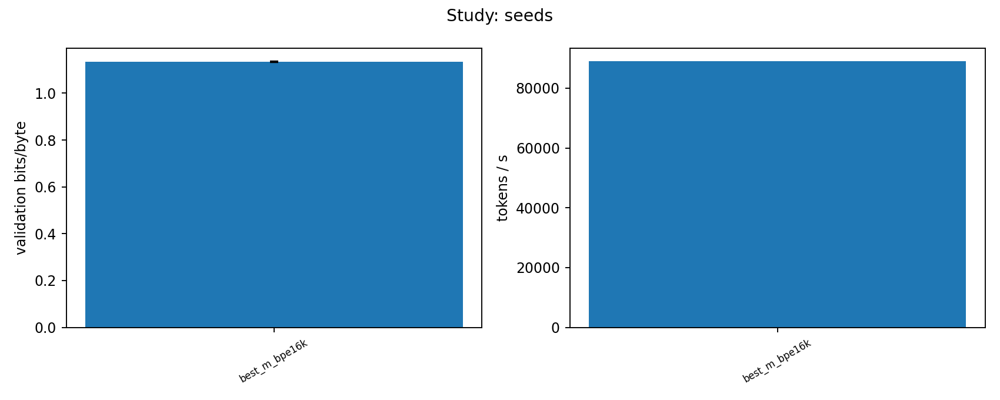

# DSA4212 Group 10 - Training Small Language Models under a Fixed Compute Budget

## Project Overview

This project investigates the relationship between model size, training data exposure, and language model performance under a fixed computational budget.

Our primary research question is:

**Under a fixed GPU-time budget, can a smaller Transformer trained on more tokens outperform a larger Transformer trained on fewer tokens?**

We implement GPT-style decoder-only Transformer language models from scratch using a nanoGPT-inspired architecture and train them on WikiText-103 using a single NVIDIA Tesla T4 GPU in Google Colab.

In addition to model size, we investigate tokenizer vocabulary size, learning-rate selection, batch-size sensitivity, and robustness across random seeds.

Our main finding is that the medium-sized model (M) achieves the lowest validation and held-out test bits-per-byte (BPB) among five model sizes trained under the same 30-minute GPU-time budget.

## 1. Key Findings

### 1.1 Model Size versus Training Tokens

Five Transformer configurations were trained for 1,800 seconds each using the BPE 16K tokenizer.

| Model | Total Parameters | Tokens Trained | Validation BPB ↓ | Test BPB ↓ |
|---|---:|---:|---:|---:|
| XS | 2.92M | 491.36M | 1.2907 | 1.3102 |
| S | 7.41M | 346.57M | 1.1862 | 1.2068 |
| **M** | **17.01M** | **187.43M** | **1.1261** | **1.1461** |
| L | 33.69M | 97.17M | 1.1375 | 1.1564 |
| XL | 97.73M | 37.26M | 1.2530 | 1.2710 |

The M model achieves the best performance despite processing fewer tokens than XS and S.

Although larger models have greater representational capacity, they process substantially fewer tokens within the same training-time budget. Conversely, very small models process more tokens but appear limited by their capacity.

These results suggest that an intermediate model size provides the best observed balance between model capacity and training throughput for this hardware and budget.


### 1.2 Tokenizer Comparison

We evaluated five tokenizers using the M-sized model.

| Tokenizer | Vocabulary Size | Validation BPB ↓ | Test BPB ↓ |
|---|---:|---:|---:|
| GPT-2 | 50,257 | 1.1793 | 1.2038 |
| BPE 4K | 4,096 | 1.1760 | 1.1921 |
| BPE 8K | 8,192 | 1.1443 | 1.1627 |
| **BPE 16K** | **16,384** | **1.1222** | **1.1447** |
| BPE 32K | 32,768 | 1.1290 | 1.1530 |

BPE 16K achieved the lowest validation BPB and was selected for subsequent experiments. It also retained the lowest BPB on the held-out test set.

Tokenizer choice affects vocabulary-related parameter costs, sequence lengths, and training throughput.


### 1.3 Batch-Size Sensitivity

We evaluated the XL model using three effective batch sizes.

| Tokens per Optimizer Step | Learning Rate | Validation BPB ↓ |
|---|---:|---:|
| 4,096 | 0.0008 | 1.3119 |
| **16,384** | **0.0016** | **1.2505** |
| 65,536 | 0.0032 | 1.4633 |

The baseline batch size of 16,384 tokens per optimizer step achieved the lowest validation BPB.

Learning rates were scaled with the square root of the batch-size ratio. Therefore, this experiment measures joint batch-size and learning-rate sensitivity rather than isolating batch size alone.


### 1.4 Seed Robustness

We repeated the M and L configurations using three random seeds: 1337, 1338, and 1339.

| Model | Seeds | Mean Validation BPB ↓ | Standard Deviation |
|---|---:|---:|---:|
| **M** | 3 | **1.13418** | 0.00181 |
| L | 3 | 1.14385 | 0.00062 |

The M model achieved lower mean validation BPB across the three seeds, while L exhibited lower observed variability.

This provides additional support for the model-size finding, although three seeds per configuration limit broader statistical conclusions.



## 2. Experimental Setup

### 2.1 Dataset

We use **WikiText-103 raw (`wikitext-103-raw-v1`)**, an English Wikipedia-derived language modelling dataset.

The dataset contains separate training, validation, and test splits.

- **Training:** Model optimization and custom tokenizer training.
- **Validation:** Learning-rate tuning, configuration selection, and robustness analysis.
- **Test:** Final held-out evaluation after model selection.

Custom byte-level BPE tokenizers are trained using only the training split. GPT-2 tokenization is provided through `tiktoken`.

The preprocessing pipeline encodes text and appends newline separators according to the dataset preparation implementation.

### 2.2 Model Architecture

Our models use a decoder-only GPT-style Transformer architecture inspired by nanoGPT.

The implementation includes causal multi-head self-attention, pre-layer normalization, learned positional embeddings, tied input/output token embeddings, and feed-forward Transformer blocks.

All model weights are randomly initialized. No pretrained neural weights or embeddings are used.

Five model sizes are compared:

| Model | Layers | Attention Heads | Embedding Dimension | Non-Embedding Parameters |
|---|---:|---:|---:|---:|
| XS | 4 | 4 | 128 | 0.79M |
| S | 4 | 4 | 256 | 3.15M |
| M | 6 | 6 | 384 | 10.62M |
| L | 8 | 8 | 512 | 25.17M |
| XL | 12 | 12 | 768 | 84.95M |

### 2.3 Compute Budget and Training Configuration

| Setting | Configuration |
|---|---|
| Platform | Google Colab |
| GPU | NVIDIA Tesla T4 (16 GB) |
| Final training budget | 1,800 seconds per run |
| Preliminary LR tuning | 300 seconds per run |
| Precision | FP16 mixed precision |
| Optimizer | AdamW |
| Context length | 256 tokens |
| Baseline effective batch | 16,384 tokens per optimizer step |
| Primary evaluation metric | Bits per byte (BPB) |
| Robustness seeds | 1337, 1338, 1339 |

The declared training budget measures optimization-step wall-clock time rather than total elapsed notebook time. Validation and checkpoint overhead are excluded.

Models are periodically checkpointed, allowing interrupted experiments to resume from saved training states.

### 2.4 Evaluation Metric

Our primary evaluation metric is **bits per byte (BPB)**, where lower values indicate better language-model predictive performance.

BPB enables comparisons between models using different tokenizers because it normalizes negative log-likelihood by the number of bytes in the evaluated text.

Token-level loss and perplexity are also recorded, but these are primarily interpreted within the same tokenizer.

## 3. Experimental Studies

We completed **36 training runs** across five studies.

| Study | Description | Completed Runs |
|---|---|---:|
| A | Learning-rate tuning | 17 |
| B | Tokenizer comparison | 5 |
| C | Model-size comparison | 5 |
| D | Batch-size sensitivity | 3 |
| E | Seed robustness | 6 |
| **Total** | | **36** |

### 3.1 Learning-Rate Tuning

We conducted five-minute learning-rate tuning experiments for XS, M, and XL.

The original sweep contained 15 runs, followed by two additional experiments at learning rate 0.0064 for XS and M.

The learning rates used in the completed final model-size experiments were:

| Model | Learning Rate |
|---|---:|
| XS | 0.0032 |
| S | 0.0032 |
| M | 0.0032 |
| L | 0.0024 |
| XL | 0.0016 |

These values are recorded in `results/tuned_lr.json`.

The additional XS tuning experiment at LR = 0.0064 improved its five-minute validation BPB relative to LR = 0.0032. However, the final XS model-size run retained LR = 0.0032. This is considered when interpreting the model-size results.

### 3.2 Tokenizer Comparison

Five tokenizers were evaluated under the same final training-time budget using the M-sized architecture.

BPE 16K was selected based on validation BPB.

### 3.3 Model-Size Comparison

The primary experiment compared XS, S, M, L, and XL using BPE 16K and the same 1,800-second training-time budget.

We measured validation BPB, total and non-embedding parameters, tokens processed, optimizer steps, throughput, and model FLOPs utilization.

### 3.4 Batch-Size Sensitivity

Three effective batch sizes were tested using XL. Learning rates were adjusted according to the square-root scaling rule.

### 3.5 Seed Robustness

M and L were each evaluated across three independent random seeds.

The results were summarized using mean validation BPB and sample standard deviation separately for each model.

## 4. Final Test Evaluation

After completing validation-based model selection, we evaluated **16 trained checkpoints** on the held-out WikiText-103 test split.

| Study | Test Evaluations |
|---|---:|
| Tokenizer comparison | 5 |
| Model-size comparison | 5 |
| Seed robustness | 6 |
| **Total** | **16** |

The three batch-size configurations were retained as validation-only sensitivity experiments.

The test evaluation loads the saved model checkpoints without retraining.

The results are available in:

- [`results/final_test.csv`](results/final_test.csv)
- [`results/final_test_comparison.csv`](results/final_test_comparison.csv)
- Individual `test_result.json` files under `results/runs/final/`

The held-out test results preserve the main validation finding: the M-sized model achieves the lowest BPB among the five model sizes.

## 5. Repository Structure

```text
DSA4212_Group_10_Assignment/
├── README.md
├── LICENSE
├── requirements.txt
├── requirements-data.txt
├── code/
│   ├── gpt.py
│   ├── train.py
│   ├── evaluate.py
│   ├── experiments.py
│   ├── run_experiments.py
│   ├── selection.py
│   ├── analyze.py
│   ├── prepare_data.py
│   ├── train_tokenizer.py
│   └── ...
├── notebooks/
│   └── DSA4212_Merged.ipynb
├── results/
│   ├── README.md
│   ├── all_experiments.csv
│   ├── headline_size_table.csv
│   ├── tuned_lr.json
│   ├── final_test.csv
│   ├── final_test_comparison.csv
│   ├── seed_individual_results.csv
│   ├── seed_robustness_summary.csv
│   ├── figures/
│   └── runs/
└── report/
    └── report_outline.md
```

The repository contains source code, lightweight experimental results, logs, and figures. Large model checkpoints and raw datasets are stored separately in Google Drive.

## 6. Reproducibility - Google Colab

The complete experimental workflow is provided in our Google Colab notebook:

**[`notebooks/DSA4212_Merged.ipynb`](notebooks/DSA4212_Merged.ipynb)**

The notebook contains the environment setup, dataset preparation, model training, hyperparameter tuning, evaluation, and analysis used in this project.

### 6.1 Open the Notebook

The notebook can be opened directly in Google Colab:

[**Open in Google Colab**](https://colab.research.google.com/drive/1nZ7aybcIU-daiwpXyWs2Jg80zbQqTpeB?usp=sharing#scrollTo=jvZy5rHhMUvW)

### 6.2 Configure the Runtime

In Colab, select:

**Runtime → Change runtime type → T4 GPU**

The original experiments used a single NVIDIA Tesla T4 with FP16 mixed precision.

Colab GPU availability and installed package versions may change over time. Training throughput and exact results may therefore differ between runs.

### 6.3 Prepare the Dataset

Download WikiText-103 raw (`wikitext-103-raw-v1`) and place the required Parquet files in Google Drive:

```text
MyDrive/
└── DSA4212/
    └── Dataset/
        ├── train-00000-of-00002.parquet
        ├── train-00001-of-00002.parquet
        ├── validation-00000-of-00001.parquet
        └── test-00000-of-00001.parquet
```

The notebook mounts Google Drive and reads the dataset from this location.

The dataset preparation cells generate the tokenized training, validation, and test files used in the experiments.

Custom BPE tokenizers are trained using the training split only.

### 6.4 Run the Notebook

Execute the notebook cells in their numbered order.

| Notebook Stage | Purpose |
|---|---|
| Environment setup | Mount Drive, configure paths, and install dependencies |
| Dataset preparation | Load and tokenize WikiText-103 |
| Preliminary checks | Validate the training pipeline |
| Section 16-A | Learning-rate tuning |
| Section 16-B | Tokenizer comparison |
| Section 16-C | Model-size comparison |
| Section 16-D | Batch-size sensitivity |
| Section 16-E | Seed robustness |
| Section 17 | Generate summary tables and figures |
| Section 18 | Final held-out test evaluation |
| Section 19 | Export results |

The training pipeline supports checkpointing and resumption. Completed experiments are identified through saved `result.json` files, while interrupted experiments can resume from compatible checkpoints.

The original full experiment suite requires substantial GPU time. Reproducing the published results from scratch may take multiple Colab sessions.

### 6.5 Saved Outputs

The notebook saves experiment outputs to Google Drive under:

```text
MyDrive/DSA4212/runs/
```

Each experiment has its own directory containing training logs, validation results, and model checkpoints.

Final test evaluations are saved as `test_result.json` files alongside their corresponding checkpoints.

The notebook also generates analysis figures and consolidated CSV tables.

### 6.6 Review Results Without Retraining

All completed experimental results are available directly in this repository.

Important files include:

- [`results/all_experiments.csv`](results/all_experiments.csv) - all 36 training runs.
- [`results/headline_size_table.csv`](results/headline_size_table.csv) - main model-size comparison.
- [`results/final_test.csv`](results/final_test.csv) - held-out test evaluation.
- [`results/final_test_comparison.csv`](results/final_test_comparison.csv) - validation versus test BPB.
- [`results/seed_robustness_summary.csv`](results/seed_robustness_summary.csv) - seed variability for M and L.
- [`results/figures/`](results/figures/) - experimental figures.
- [`results/runs/`](results/runs/) - individual experiment metrics and logs.

See [`results/README.md`](results/README.md) for a detailed description of the result files.

### 6.7 Reproducibility Considerations

All neural models were trained from random initialization without pretrained weights.

Validation BPB was used for hyperparameter tuning and model selection. The held-out test set was evaluated after these decisions were fixed.

Exact numerical reproduction may be affected by random initialization, software versions, GPU performance, and wall-clock training variability.

The repository does not include raw datasets or large model checkpoints. Reproducing the final checkpoint-based evaluations without retraining requires access to the original saved checkpoints and identically prepared tokenized datasets.

## 7. Limitations

Our conclusions are specific to WikiText-103, the selected GPT-style architectures, the NVIDIA T4 GPU, and the fixed 30-minute training-time budget.

The experimental budget is based on optimization-step wall-clock time rather than equal total FLOPs. Different model sizes therefore process different numbers of tokens and may use different amounts of computation.

Model size was varied by changing both depth and width, so the effects of these architectural dimensions were not isolated.

The expanded learning-rate sweep suggests that the final XS model may not be optimally tuned.

The seed robustness study includes only three seeds per model. Furthermore, the models were evaluated on a single dataset and task.

BPB measures next-token predictive performance and does not directly capture downstream reasoning, instruction-following, or generation quality.

## 8. References

1. Hoffmann et al. (2022). *Training Compute-Optimal Large Language Models.* https://arxiv.org/abs/2203.15556
2. Merity et al. (2016). *Pointer Sentinel Mixture Models.* https://arxiv.org/abs/1609.07843
3. Karpathy. *nanoGPT.* https://github.com/karpathy/nanoGPT
4. Muennighoff et al. (2023). *Scaling Data-Constrained Language Models.* https://arxiv.org/abs/2305.16264